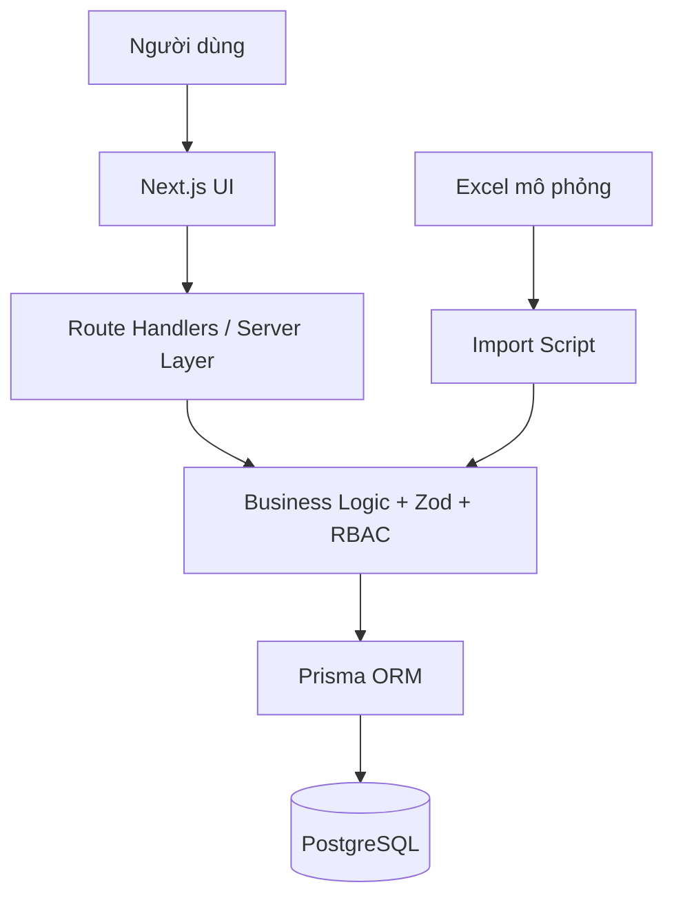
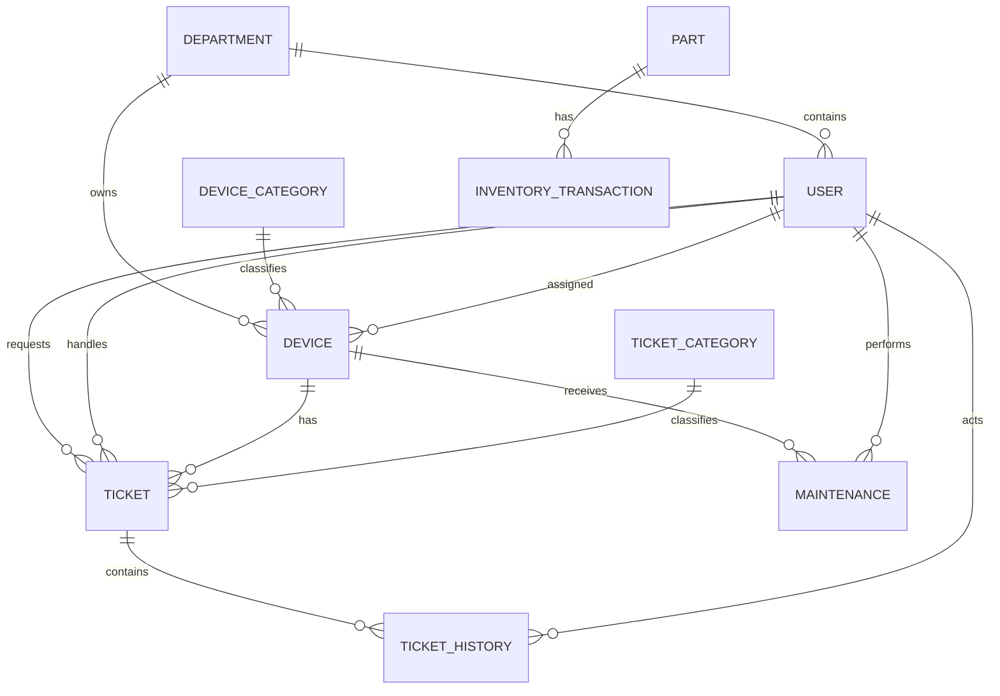

# ĐẶC TẢ HỆ THỐNG
## Hệ thống quản lý thiết bị CNTT và yêu cầu hỗ trợ kỹ thuật

### 1. Thông tin chung

**Tên đề tài:** Xây dựng hệ thống quản lý thiết bị CNTT và yêu cầu hỗ trợ kỹ thuật tại Công ty TNHH JDT Việt Nam.

**Loại sản phẩm:** Web application nội bộ phục vụ minh họa học tập/thực tập tốt nghiệp.

**Nguồn dữ liệu:** Workbook `Bo_du_lieu_mau_JDT_Quan_ly_thiet_bi_CNTT_Ho_tro_ky_thuat.xlsx`.

**Lưu ý:** Toàn bộ dữ liệu trong workbook là dữ liệu mô phỏng phục vụ phát triển, kiểm thử và báo cáo. Không phản ánh dữ liệu vận hành thực tế của doanh nghiệp.

---

### 2. Bài toán

Trong môi trường doanh nghiệp sản xuất, nhiều bộ phận sử dụng máy tính, máy in, máy quét mã vạch, thiết bị đầu cuối, thiết bị mạng và các thiết bị CNTT khác. Khi số lượng thiết bị và yêu cầu hỗ trợ tăng, việc theo dõi bằng nhiều bảng rời rạc dễ gây khó khăn trong tra cứu lịch sử, xác định trạng thái xử lý, theo dõi bảo trì và tổng hợp báo cáo.

Hệ thống được xây dựng để tập trung các thông tin này vào một nền tảng thống nhất, với trọng tâm là quản lý thiết bị CNTT và quy trình tiếp nhận – xử lý – hoàn thành yêu cầu hỗ trợ kỹ thuật.

---

### 3. Mục tiêu

1. Số hóa danh mục thiết bị CNTT và thông tin liên quan.
2. Chuẩn hóa quy trình quản lý yêu cầu hỗ trợ kỹ thuật.
3. Lưu lịch sử xử lý để có thể truy vết.
4. Theo dõi bảo trì/sửa chữa theo từng thiết bị.
5. Theo dõi linh kiện phục vụ hỗ trợ kỹ thuật ở mức cơ bản.
6. Cung cấp dashboard và báo cáo thống kê.
7. Tận dụng bộ dữ liệu mô phỏng lớn để kiểm thử khả năng quản lý và tra cứu.

---

### 4. Phạm vi

#### Trong phạm vi
- Đăng nhập và phân quyền.
- Quản lý bộ phận/người dùng.
- Quản lý thiết bị CNTT.
- Ticket hỗ trợ kỹ thuật.
- Timeline xử lý ticket.
- Bảo trì/sửa chữa.
- Linh kiện và giao dịch linh kiện.
- Dashboard/báo cáo.
- Import/export Excel.

#### Ngoài phạm vi
- Quản lý dây chuyền hoặc máy móc sản xuất chuyên dụng.
- ERP, kế toán, nhân sự đầy đủ.
- Quản lý bảo hành khách hàng.
- Mobile app native.
- AI chatbot.
- Microservices.
- IoT/giám sát realtime.

---

### 5. Đối tượng sử dụng

#### Admin
Quản trị dữ liệu, người dùng, danh mục, import/export và toàn bộ nghiệp vụ.

#### IT Support
Tiếp nhận và xử lý yêu cầu; theo dõi thiết bị; ghi nhận bảo trì và linh kiện.

#### User
Gửi yêu cầu hỗ trợ, theo dõi trạng thái, xem lịch sử của yêu cầu do mình tạo và đánh giá sau khi hoàn thành.

---

### 6. Yêu cầu chức năng

#### FR-01 — Xác thực
- Đăng nhập, đăng xuất.
- Phiên đăng nhập bảo mật.
- Phân quyền server-side.

#### FR-02 — Dashboard
- KPI tổng thiết bị, thiết bị đang sử dụng, ticket, ticket mở/hoàn thành, bảo trì.
- Chart theo trạng thái, nhóm sự cố, tháng, bộ phận.

#### FR-03 — Thiết bị
- Danh sách, tìm kiếm, filter, sort, pagination.
- Thêm/sửa/xem chi tiết.
- Liên kết người sử dụng và bộ phận.
- Xem ticket và bảo trì của thiết bị.

#### FR-04 — Ticket
- Tạo ticket.
- Phân loại, ưu tiên, phân công.
- Cập nhật trạng thái.
- Ghi hướng xử lý.
- Timeline lịch sử tự động.
- Rating 1–5 sau hoàn thành.

#### FR-05 — Bảo trì
- Danh sách và tạo lịch sử bảo trì/sửa chữa.
- Gắn với thiết bị, người thực hiện, chi phí và ngày kiểm tra tiếp theo.

#### FR-06 — Linh kiện
- Danh mục linh kiện.
- Tồn hiện tại và mức tối thiểu.
- Cảnh báo tồn thấp.
- Nhập/xuất/điều chỉnh có lịch sử.

#### FR-07 — Báo cáo
- Thống kê và chart.
- Export danh sách đã lọc.

#### FR-08 — Import Excel
- Đọc workbook chuẩn.
- Validate.
- Upsert theo mã nghiệp vụ.
- Báo cáo lỗi/thành công.
- Không tính lại stock từ giao dịch lịch sử trong lần import ban đầu.

---

### 7. Yêu cầu phi chức năng

- Giao diện tiếng Việt, dễ sử dụng.
- Tối ưu cho desktop; responsive cho tablet/mobile.
- Bảng dữ liệu lớn phải pagination.
- Validate input ở server.
- Có index DB cho field lọc phổ biến.
- Password hash, không lưu plain text.
- Không hardcode số liệu dashboard.
- Không công khai secret.
- Có audit trail tối thiểu cho ticket qua TicketHistory.
- Dữ liệu mô phỏng phải được ghi chú rõ trong UI và README.

---

### 8. Kiến trúc

**Modular Monolith + 3 lớp**:

1. Presentation: Next.js/React UI, Route Handlers.
2. Application/Domain: service, validation, RBAC, workflow.
3. Data: Prisma ORM + PostgreSQL.



---

### 9. Mô hình dữ liệu đề xuất

#### Department
- id
- code UNIQUE
- name

#### User
- id
- employeeCode UNIQUE
- fullName
- departmentId
- title
- email
- phone
- status
- role
- passwordHash (nếu tài khoản được phép login)

#### DeviceCategory
- id
- name UNIQUE

#### Device
- id
- code UNIQUE
- categoryId
- brand
- model
- serial UNIQUE/nullable theo policy
- departmentId
- assignedUserId nullable
- status
- purchaseDate
- warrantyEndDate
- location
- condition

#### TicketCategory
- id
- name UNIQUE

#### Ticket
- id
- code UNIQUE
- receivedAt
- requesterId
- departmentId
- deviceId nullable
- categoryId
- description
- priority
- status
- channel
- assigneeId nullable
- resolutionHours nullable
- completedAt nullable
- resolution nullable
- rating nullable

#### TicketHistory
- id
- code UNIQUE
- ticketId
- happenedAt
- action
- content
- actorId

#### Maintenance
- id
- code UNIQUE
- deviceId
- performedAt
- maintenanceType
- performerId
- result
- cost
- nextCheckAt nullable

#### Part
- id
- code UNIQUE
- name
- unit
- stockQuantity
- minimumStock
- unitPrice
- storageLocation
- status

#### InventoryTransaction
- id
- code UNIQUE
- happenedAt
- partId
- type
- quantity
- reference nullable
- note nullable

---

### 10. ERD



---

### 11. Mapping workbook

| Sheet | Dùng cho | Số dòng dữ liệu hiện tại |
|---|---|---:|
| 01_Danh_muc | Bộ phận, loại thiết bị, nhóm sự cố, enum/danh mục | 12 dòng danh mục ghép |
| 02_Nguoi_dung | User/Employee | 180 |
| 03_Thiet_bi_CNTT | Device | 900 |
| 04_Yeu_cau_ho_tro | Ticket | 3.500 |
| 05_Lich_su_xu_ly | TicketHistory | 13.224 |
| 06_Bao_tri_sua_chua | Maintenance | 1.500 |
| 07_Linh_kien | Part | 120 |
| 08_Giao_dich_linh_kien | InventoryTransaction | 1.800 |
| 09_Dashboard | Dùng đối chiếu số liệu mẫu; không import làm nguồn KPI | — |

Sheet `09_Dashboard` chỉ là dashboard Excel minh họa. Ứng dụng phải tính KPI trực tiếp từ DB.

---

### 12. Các cột nguồn Excel

#### 02_Nguoi_dung
`Mã người dùng, Họ và tên, Mã bộ phận, Bộ phận, Chức danh, Email mẫu, Số điện thoại mẫu, Trạng thái`

#### 03_Thiet_bi_CNTT
`Mã thiết bị, Loại thiết bị, Hãng, Model, Serial mẫu, Mã bộ phận, Bộ phận, Trạng thái, Người sử dụng, Ngày mua, Hết bảo hành, Vị trí, Tình trạng`

#### 04_Yeu_cau_ho_tro
`Mã yêu cầu, Thời điểm tiếp nhận, Người yêu cầu, Mã bộ phận, Bộ phận, Mã thiết bị, Nhóm sự cố, Mô tả, Mức ưu tiên, Trạng thái, Kênh tiếp nhận, Người phụ trách, Thời gian xử lý (giờ), Thời điểm hoàn thành, Kết quả/Hướng xử lý, Đánh giá`

#### 05_Lich_su_xu_ly
`Mã lịch sử, Mã yêu cầu, Thời điểm, Hành động, Nội dung cập nhật, Người thực hiện`

#### 06_Bao_tri_sua_chua
`Mã bảo trì, Mã thiết bị, Loại thiết bị, Bộ phận, Ngày thực hiện, Loại công việc, Người thực hiện, Kết quả, Chi phí mẫu (VNĐ), Ngày kiểm tra tiếp theo`

#### 07_Linh_kien
`Mã linh kiện, Tên linh kiện, Đơn vị tính, Tồn kho mẫu, Mức tồn tối thiểu, Đơn giá mẫu (VNĐ), Vị trí lưu, Trạng thái, Cảnh báo`

#### 08_Giao_dich_linh_kien
`Mã giao dịch, Ngày, Mã linh kiện, Tên linh kiện, Loại giao dịch, Số lượng, Tham chiếu, Ghi chú`

---

### 13. Danh mục từ workbook

**Bộ phận:** Ban Giám đốc; Hành chính - Nhân sự; Kế toán; Mua hàng; Kho nguyên liệu; Kho thành phẩm; Sản xuất 1; Sản xuất 2; QA/QC; Kỹ thuật - Bảo trì; Công nghệ thông tin.

**Nhóm sự cố:** Phần cứng; Phần mềm; Kết nối mạng; Máy in/Thiết bị ngoại vi; Tài khoản/Quyền truy cập; Dữ liệu/Báo cáo; Cài đặt/Cấu hình; Khác.

**Mức ưu tiên:** Thấp; Trung bình; Cao; Khẩn cấp.

**Trạng thái ticket:** Mới tiếp nhận; Đang xử lý; Chờ phản hồi; Tạm hoãn; Hoàn thành.

**Kênh tiếp nhận:** Biểu mẫu nội bộ; Điện thoại; Email; Trực tiếp.

---

### 14. Route giao diện đề xuất

```text
/login
/dashboard
/devices
/devices/[id]
/tickets
/tickets/new
/tickets/[id]
/maintenance
/maintenance/[id]
/inventory/parts
/inventory/parts/[id]
/inventory/transactions
/reports
/admin/users
/admin/departments
/admin/categories
/admin/import
```

---

### 15. Dashboard dự kiến

KPI:
- Tổng thiết bị CNTT.
- Thiết bị đang sử dụng.
- Tổng yêu cầu hỗ trợ.
- Yêu cầu đã hoàn thành.
- Yêu cầu đang mở.
- Số lượt bảo trì/sửa chữa.

Chart:
- Ticket theo trạng thái.
- Ticket theo nhóm sự cố.
- Ticket theo tháng.
- Ticket theo bộ phận.

Tất cả query từ PostgreSQL.

---

### 16. Quy tắc ticket workflow

- Mới tiếp nhận → Đang xử lý / Tạm hoãn.
- Đang xử lý → Chờ phản hồi / Tạm hoãn / Hoàn thành.
- Chờ phản hồi → Đang xử lý / Tạm hoãn / Hoàn thành.
- Tạm hoãn → Đang xử lý / Hoàn thành.
- Hoàn thành → kết thúc; chỉ Admin được mở lại.

Khi đổi trạng thái, phân công người xử lý hoặc cập nhật kết quả, hệ thống phải ghi TicketHistory.

---

### 17. Import strategy

- Đọc workbook bằng `xlsx`.
- Chuyển Excel date serial chính xác.
- Chuẩn hóa chuỗi trim/nullable.
- Import/upsert theo code.
- Xử lý theo batch.
- Dùng transaction ở các nhóm hợp lý.
- Báo lỗi theo sheet + row + field.
- Verify FK trước hoặc trong import.
- Không import Dashboard làm dữ liệu nghiệp vụ.
- Không replay giao dịch lịch sử để tính lại số tồn ban đầu.

---

### 18. Tiêu chí nghiệm thu

1. Có hướng dẫn cài đặt từ máy mới.
2. PostgreSQL chạy local bằng Docker.
3. Prisma migration chạy được.
4. Import Excel thành công.
5. Có login và RBAC.
6. Dashboard query DB.
7. Thiết bị có CRUD/chi tiết/ticket/bảo trì.
8. Ticket có workflow/timeline.
9. Bảo trì hoạt động.
10. Linh kiện/giao dịch cập nhật tồn an toàn.
11. Có filter, search, pagination trên danh sách lớn.
12. Có export.
13. Có test luồng chính.
14. Không hardcode dữ liệu thay cho DB.
15. Hiển thị rõ dữ liệu là mô phỏng.
